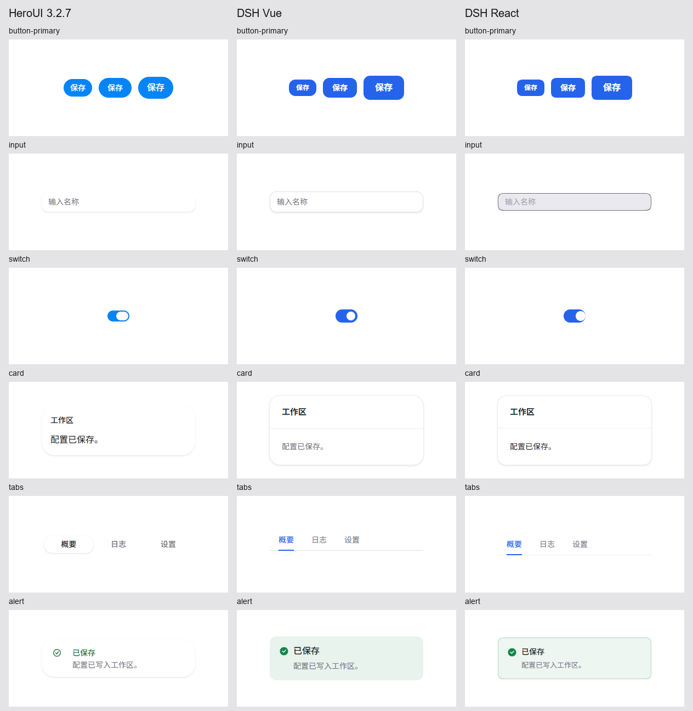
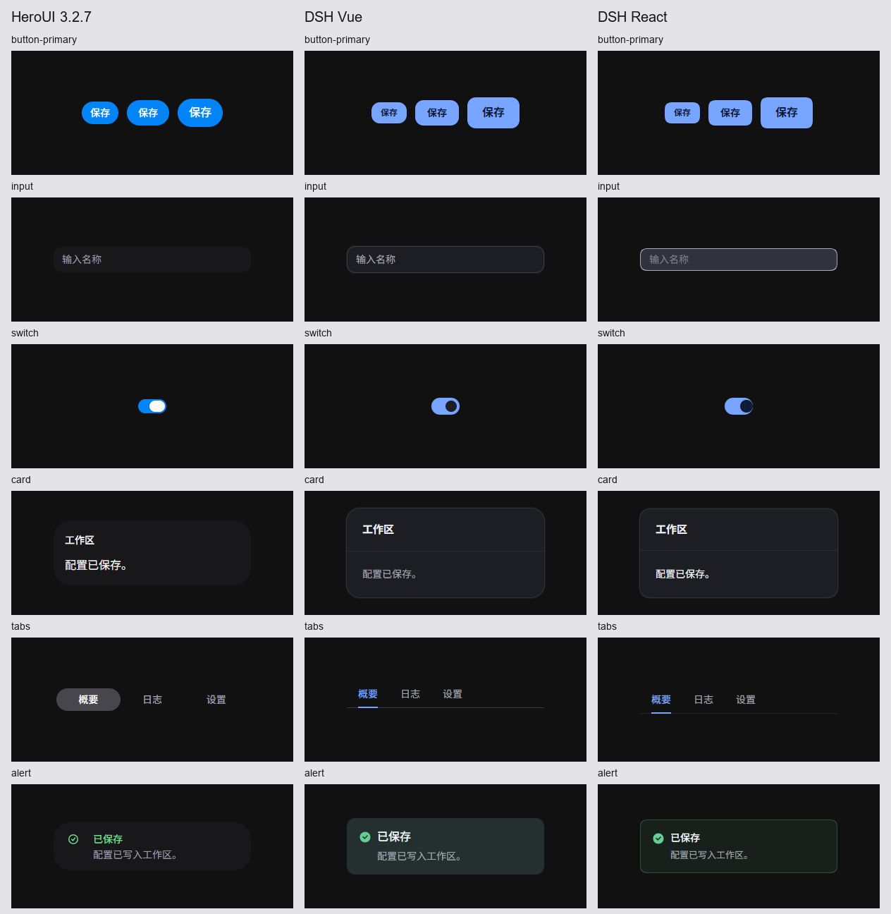
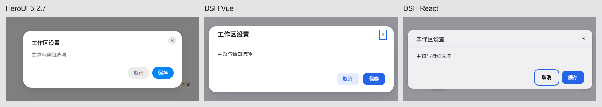

# HeroUI 像素对照

当前 DSH Vue 和 React 组件与官方 HeroUI 3.2.7 存在明确像素差异，两端各 44 个组件和主题组合中，完全相同的组合均为 0。

## 参考页与测量条件

官方参考项目位于 `../hero-reference`，直接安装精确版本 `@heroui/react@3.2.7` 和 `@heroui/styles@3.2.7`。基准按照[官方快速开始](https://heroui.com/en/docs/react/getting-started/quick-start)加载 Tailwind CSS 与 HeroUI 样式。DSH 组件使用 Vue 分支 `51b7f1c` 和 React 分支 `102675b` 的实现。

| 页面 | 地址 |
| --- | --- |
| 官方 HeroUI | http://127.0.0.1:5180/?theme=light |
| DSH Vue 对照 | http://127.0.0.1:5178/?compare=1&theme=light |
| DSH React 对照 | http://127.0.0.1:5179/?compare=1&theme=light |

三个页面使用相同的 22 组内容、400×176 样本框、Arial 字体，以及固定画布。颜色、圆角、阴影、描边和组件内部排版由各自组件实现提供。`theme=dark` 切换深色，附加 `state=modal` 打开默认弹窗。

测量日期为 2026-11-16。三个页面在同一台 Windows 设备、同一 IAB Chromium 浏览器中，以 1280×960 视口、DPR 1 和关闭动画的条件采样。通过 CDP 保存原始 PNG，完整画布为 1280×1844；逐项裁图保持原尺寸。六组页面均重复采样，连续两张截图完全相同。采样时确认字体已加载、文本域为“工作区说明”、进度填充宽度为 173.594px（280px 的 62%）、骨架屏为 280×48。

## 测量结果

| 与官方比较 | 浅色差异像素 | 深色差异像素 | 完全一致的组合 |
| --- | ---: | ---: | ---: |
| DSH Vue | 6.955% | 12.886% | 0 / 44 |
| DSH React | 7.334% | 12.781% | 0 / 44 |

每个主题的分母为 22×400×176，即 1,548,800 个像素，包含样本中的留白。差异比例表示逐像素 RGB 不相等的面积比例。各组件结果见[逐项表](results/summary.md)，完整原始计数及误差见 [metrics.json](results/metrics.json)。

| 可复核的属性 | HeroUI 3.2.7 | DSH Vue | DSH React |
| --- | --- | --- | --- |
| 主按钮 sm / md / lg 高度 | 32 / 36 / 40px | 30 / 36 / 44px | 30 / 36 / 44px |
| 主按钮圆角 | 24px | 12px | 12px |
| 主按钮字重 | 500 | 600 | 600 |
| 浅色主按钮背景 | `oklch(0.6204 0.195 253.83)` | `rgb(37, 99, 235)` | `rgb(37, 99, 235)` |
| 深色主按钮前景 | 接近白色 | 深蓝色 | 深蓝色 |
| 默认 Tabs 选中外观 | 胶囊表面 | 下划线 | 下划线 |
| 卡片标题与正文 | 无分隔线 | 标题下分隔线 | 标题下分隔线 |
| 默认弹窗宽度 | 448px | 520px | 520px |
| 默认弹窗高度 | 162.016px | 187px | 167px |
| 默认弹窗圆角 | 24px | 20px | 20px |

浅色并排图，依次为官方、Vue、React：

## 样本映射与复现

React 的 `ghost` 对应现有 `Button variant="text"`，状态标签使用 `Tag tone="success"`；Vue 使用 `Tag color="green"`。Select 三页都显示“均衡”，React 样本使用受控 `value`。骨架屏固定为 280×48。表格关闭分页，以相同两列两行比较；Tooltip 样本比较关闭状态的触发按钮。弹窗保留各自默认宽度、表面和布局。

在 Vue 和 React 各自工作树执行 `npm run preview`，在 `docs/hero-reference` 执行 `npm ci`、`npm run dev` 启动参考页。固定浏览器视口与 DPR 后，保存 PNG 及 `[data-sample]` 的页面坐标，文件结构参考 `results` 下的 JSON。使用 Python 3、Pillow 和 NumPy 执行 `py -3 docs/comparison/compare.py docs/comparison/results` 可重算结果、差异图、叠加图和并排图。

`diff-*.png` 中红色表示发生变化，深红表示最大 RGB 通道差大于 8；`overlay-*.png` 为两实现 50% 透明度叠加。原始截图、测量坐标、按钮计算样式和弹窗几何均保存在 `results` 中。截图测量覆盖上述默认状态以及浅深主题。
